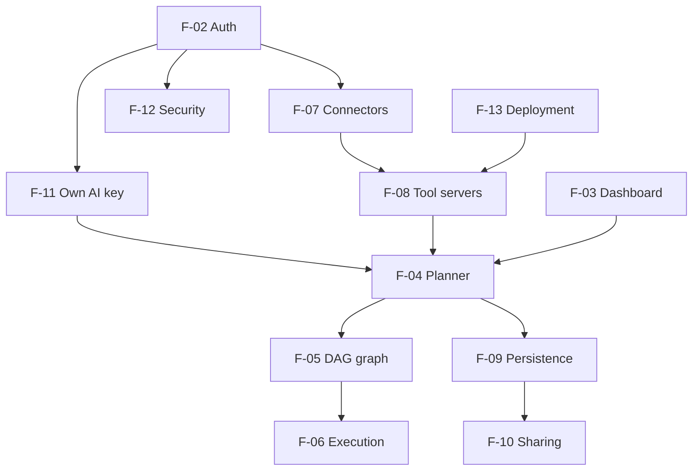

# Feature-by-Feature Development History

> **How to read this.** "Baseline" = committed history (22 unique changes, 2026-04-10 → 2026-08-06). "Working tree" = uncommitted changes from the AI-assisted session of 2026-10-28 ([team-contributions](team-contributions.md) §4). For features whose historical sequence cannot be rebuilt, only the *current* implementation is described and the history is marked **[UNKNOWN]**. Test results: **no automated test exists for any feature**; "ad hoc" results come from checks run once during the 2026-10-28 session and are not reproducible from the repository ([testing-and-quality-assurance](testing-and-quality-assurance.md)).

---

## F-01 — Landing page and marketing UI
1. **Problem:** visitors need to understand the product and reach sign-up.
2. **User story:** As a visitor, I want a clear landing page so that I can decide whether to sign up.
3. **Requirements:** hero, feature list, integrations section, call to action.
4. **Files:** `src/app/page.tsx`, `src/components/landing/*`, `src/components/shared/{Nav,PillNav,TextType,Button}.tsx`.
5. **Design:** client-side React with GSAP/framer-motion animation; "Get started" routes to `/dashboard` when authenticated, otherwise `/auth`.
6. **Dependencies:** F-02 session state.
7. **Implementation:** Baseline. **Commits:** `f186bf3`/`676bb25` (2026-04-10). **Contributors:** M1 [PARTIALLY VERIFIED].
8. **Testing approach / results:** none; NOT EXECUTED.
9. **Limitations:** marketing copy still says "GPT-4o plans your workflow" (in `src/app/page.tsx`), which is no longer accurate now that five providers are supported. [VERIFIED]
10. **Status:** Implemented. **Future:** update copy; accessibility review.
11. **Lessons:** keep product claims in one place so they follow the code.
12. **Agile representation:** one Done card (T-001); copy fix would be a Ready card.

## F-02 — Authentication and accounts
1. **Problem:** every workflow and connection must belong to one user.
2. **User story:** PB-001.
3. **Requirements:** email+password and Google sign-in; hashed passwords; protected APIs; no account enumeration on login.
4. **Files:** `src/lib/nextauth.ts`, `src/lib/auth.config.ts`, `src/lib/users.ts`, `src/lib/rateLimit.ts`, `src/app/api/auth/signup/route.ts`, `src/components/auth/*`, `src/middleware.ts`, `src/types/next-auth.d.ts`.
5. **Design:** NextAuth v5 with JWT sessions; the app-wide user id is the MongoDB `users._id`. Google sign-in requests identity scopes only; Gmail/Drive access is a separate connector (F-07).
6. **Dependencies:** MongoDB `users` (unique email index).
7. **History:** *Baseline* had Google-only sign-in requesting Gmail/Drive scopes at login, a `userId` derived from the e-mail (`u` + 8 characters), and login/sign-up forms that called `/api/auth/login` and `/api/auth/signup` — **routes that did not exist in the committed tree** [VERIFIED by `git ls-tree`]. *Working tree* adds credentials auth (bcrypt cost 12), Google email-verified linking, per-email login rate limiting and a signup rate limit. **Contributors:** baseline M1/M2 [UNKNOWN which]; working tree AI-S1.
8. **Testing:** ad hoc (TC-A01–A05): signup 201, duplicate 409, weak password 400, wrong password rejected, correct password creates session, 401 on protected APIs. No automated tests.
9. **Limitations:** rate limiting is in-memory (resets on restart, per instance); "forgot password" is not implemented (the form says so).
10. **Bugs/issues:** ISS-007, ISS-013. **Integration challenge:** Google "Access blocked: missing client_id" when OAuth variables were empty — the button is now hidden until configured.
11. **Status:** Implemented (credentials part uncommitted). **Future:** password reset, email verification, shared rate-limit store.
12. **Lessons:** forms and endpoints were built apart and never connected; an end-to-end smoke test would have caught it.
13. **Agile representation:** T-011 (Code Review), PB-001.

## F-03 — Dashboard workspace
1. **Problem:** users need one screen for chats, plans and connections.
2. **Story:** PB-008. **Requirements:** workflow list, chat, DAG panel, integrations panel, AI-key manager.
3. **Files:** `src/components/dashboard/{DashboardShell,ChatPanel,Sidebar,IconRail,IntegrationsSlideover,DagPanel,LlmKeyModal}.tsx`, `src/hooks/useSessionManager.ts`, `src/app/dashboard/page.tsx`.
4. **Design:** client components, state in a custom hook; one `POST /agent/message` call per turn; custom events open the integrations and key panels.
5. **History:** *Baseline* `3a48472`/`1b62977` "dashboard and oauth done" (M1); `108f04a` edits `useSessionManager.ts` (M1); orchestration state added in `941b6c6` (M2). *Working tree* adds key modal, notices for failed connections, single-call chat.
6. **Testing:** NOT EXECUTED. **Limitations:** a missing message text once crashed the chat renderer (fixed: ISS-014); no loading/error states for every API.
7. **Status:** Implemented. **Future:** component tests.
8. **Agile:** T-002, T-009 (Done); T-014 (Code Review).

## F-04 — Conversational workflow planner (human-in-the-loop)
1. **Problem:** turn a request into a safe, reviewable plan.
2. **Story:** PB-003. **Requirements:** ask one question when information is missing; only known tools; required parameters present; confirm before executing; remember context; never invent recipients.
3. **Files:** `mcp_agent/app/services/{orchestrator,plan,agent_graph,gemini,llm}.py`, `mcp_agent/app/routes/query.py`.
4. **Design (working tree):** LangGraph state machine — detect connectors → (blocked | ingest → plan ⟲ validate/retry → finish | give up). State checkpointed in MongoDB with a 7-day TTL. Plans are validated (known tools, required params from `REQUIRED_FIELDS`, placeholder detection, graph consistency) and fed back to the model on failure (≤2 retries). Weaker models receive a trimmed tool list, worked examples and a checklist.
5. **History:** *Baseline* `941b6c6` (M2): GPT-4o orchestrator, global key, stateless `/orchestrate`, full history resent by the browser. *Working tree:* per-user keys, LangGraph state, validation, prompt tuning, model fail-over for Gemini, friendlier provider-error messages.
6. **Testing:** ad hoc with a fake OpenAI-compatible server (TC-P01–P04). Quality with real models was **never benchmarked**.
7. **Limitations:** quality depends on the user's model; free tiers impose per-minute token caps (ISS-009); the model can still pick wrong dependencies.
8. **Issues:** ISS-009, ISS-012. **Challenges:** provider differences (JSON mode, error shapes, retired model names).
9. **Status:** Implemented. **Future:** PB-028 benchmark; tool-use APIs instead of free-form JSON.
10. **Lessons:** a validator plus retry loop made weaker models usable; provider details change faster than code.
11. **Agile:** T-004 (Done), T-015 (Code Review).

## F-05 — DAG visualisation and layout
1. **Problem:** show a plan whose structure (parallel branches, joins) is understandable.
2. **Story:** PB-004. **Files:** `src/components/dashboard/{DagPanel,DagFlowNode}.tsx`, `src/lib/dagUtils.ts`, `src/app/dag/[id]/page.tsx`, `mcp_agent/app/services/plan.py`.
3. **Design (working tree):** the model supplies only `depends_on`; the server derives edges (declared dependencies + `{node_x.field}` references + known implicit GitHub dependencies), removes redundant edges, assigns layers by longest path and positions nodes side by side. Cycles are broken by keeping only earlier-pointing dependencies.
4. **History:** *Baseline* `941b6c6` DagPanel; `d078b21` fixed `TypeError … reading 'x'` by adding `sanitizeNodes` (M2). Models used to draw straight chains, so plans were sequential. *Working tree* graph builder.
5. **Testing:** ad hoc offline: a flat 15-step plan became a 6-layer graph (TC-G01). **Limitations:** implicit-dependency rules cover GitHub only; the model can omit other dependencies.
6. **Status:** Implemented. **Agile:** T-004, T-006 (Done), T-016 (Code Review).

## F-06 — DAG execution engine
1. **Problem:** run the approved plan against real services reliably.
2. **Story:** PB-005. **Files:** `mcp_agent/app/services/executor.py`, `mcp_agent/app/routes/query.py` (`/execute-dag`).
3. **Design (working tree):** wave-based concurrency (`ThreadPoolExecutor`, max 4); a node runs when its dependencies have finished; failed or skipped dependencies cause "Skipped"; `{node.field}` references resolved from earlier results; errors translated for humans (e.g. disabled Google API, revoked token); the user id is forced server-side so model-supplied ids are ignored.
4. **History:** *Baseline* sequential loop with local `required_fields` map. *Working tree* parallel waves, shared `REQUIRED_FIELDS`, skip logic.
5. **Testing:** ad hoc with stubbed tool calls (TC-X01): 15 nodes ran in 6 waves; failure of one branch skipped only its dependents. One real Gmail workflow was executed by a user on 2026-10-28 (container log shows a message id and label applied; log not retained). [PARTIALLY VERIFIED]
6. **Limitations:** a `{user}` lookup runs once per node that needs it; no resume of failed runs (PB-026).
7. **Status:** Implemented. **Agile:** T-016.

## F-07 — OAuth connectors (GitHub, Discord, Google)
1. **Problem:** act on a user's accounts only with their consent.
2. **Story:** PB-006. **Files:** `src/app/api/oauth/{github,discord,google}/**`, `src/lib/{oauthState,integrations}.ts`, `src/app/api/integrations/**`.
3. **Design (working tree):** server-side connect → provider consent → callback; `state` is a signed 10-minute JWT bound to the logged-in user plus an HTTP-only nonce cookie; tokens saved per user in `integrations.providers[]`; Google requests `access_type=offline` to obtain a refresh token.
4. **History:** *Baseline* `3a48472` (M1) first version; `5d647c6` (M2) nested provider schema and duplicate guard; M1 edited the integrations route four times on 2026-04-12. *Working tree* removes unauthenticated write endpoints, signs state, separates Google login from the Gmail/Drive connector, adds disconnect.
5. **Testing:** ad hoc: forged state and another user's valid state rejected (TC-O01–O02). Real consent flows were not run by the documentarian.
6. **Limitations:** **connector tokens are stored in plaintext** (ISS-008, PB-021). **Challenges:** provider setup (redirect URIs, test users, API enablement) outside the code (ISS-011).
7. **Status:** Implemented. **Agile:** T-002, T-003, T-009 (Done); T-012 (Code Review).

## F-08 — Dockerised tool servers
1. **Problem:** give the planner concrete, safe actions.
2. **Files:** `mcp_agent/github_mcp/server.py` (21 tools), `google_mcp/server.py` (20: Gmail 11, Sheets 9), `discord_mcp/main.py` (10), `twilio_mcp/main.py` (5), `multiplication_mcp/server.py` (demo); `docker-compose.yml`.
3. **Design:** one FastAPI service per provider, `POST /invoke/<provider>.<tool>`, tokens read from MongoDB per `user_id`.
4. **History:** *Baseline* (M2 touched github/google servers; discord/twilio authorship **[UNKNOWN]**). *Working tree:* `github.update_repo` added after a failed attempt to change repository visibility; Twilio requires an explicit recipient and works on trial accounts through a URL-hosted TwiML fallback; speech uses a voice that supports Hindi.
5. **Testing:** endpoint registration and empty-input rejection checked ad hoc (TC-T01–T02); a read-only Gmail call reached the API; Twilio account/number lookups were read-only. Most tools **NOT EXECUTED**.
6. **Limitations:** the servers do not authenticate callers (bound to localhost / the Docker network only — ISS-015); Twilio uses one shared platform account (PB-022).
7. **Status:** Implemented. **Agile:** T-017 (Code Review).

## F-09 — Chat and workflow persistence
1. **Files:** `src/lib/models/Chat.ts`, `src/lib/models/Session.ts` (legacy), `src/app/api/chats/**`.
2. **Design:** one `chats` document per workflow (history, `react_flow`, completion flag). `session_id` semantics differ between the `chats` documents created by `/api/chats/new` (`s001`…) and the ids the browser sends (Mongo `_id`), a latent inconsistency. [PARTIALLY VERIFIED by reading `useSessionManager.ts` and `chats/new/route.ts`]
3. **History:** baseline [UNKNOWN sequence]; the unauthenticated `user_id`-from-body bug in `/api/chats/append` was fixed in the working tree.
4. **Testing:** NOT EXECUTED. **Status:** Implemented. **Agile:** no per-feature card in history.

## F-10 — Workflow sharing and export
1. **Files:** `WorkflowShareModal.tsx`, `src/app/dag/[id]/page.tsx`, `src/app/api/chats/[id]/public/route.ts`.
2. **Design:** a public read-only page and JSON export; the public route returns any chat by id with no "shared" flag (PB-023). **History:** [UNKNOWN]. **Testing:** NOT EXECUTED.

## F-11 — Bring-your-own AI key (five providers)
1. **Problem:** a shared platform key was a cost and security liability; many users have only free tiers.
2. **Story:** PB-002. **Files:** `src/lib/llmKeys.ts`, `src/lib/crypto.ts`, `src/app/api/llm-keys/route.ts`, `src/components/dashboard/LlmKeyModal.tsx`, `mcp_agent/app/{services/llm.py,crypto.py}`.
3. **Design:** keys validated for format and checked live with the provider; stored AES-256-GCM encrypted (`ENCRYPTION_KEY`); the browser only ever sees the last four characters; one key is *active*; the backend picks models per provider and, for Gemini, ranks models from the live list and fails over on 404/429/503 because a listed model may not be usable.
4. **Testing:** invalid keys rejected by the real provider APIs; TS↔Python crypto round trip; switching tested against the database (TC-K01–K05). **A real planning run with each provider was not part of a reproducible test** — and live calls with users' own keys exhausted their free quotas during development (ISS-016).
5. **Limitations:** Gemini key format is a moving target (new `AQ.…` format had to be accepted); open-model plan quality is lower. **Status:** Implemented, uncommitted. **Agile:** T-014.

## F-12 — Security hardening
1. **Problem:** the committed code trusted client-supplied ids and exposed unauthenticated writes (ISS-007).
2. **Story:** PB-012. **Changes (working tree):** signed backend JWT (`aud=mcp_agent`, 10 minutes) as the only source of `user_id`; removal of `/api/integrations/upsert` and `/api/auth/sync` and of the Python integration-write router; signed OAuth state; AES-GCM for stored LLM keys; rate limits; CORS limited to the app origin and no API docs; services bound to `127.0.0.1`; removal of a debug print that listed every user's chats.
3. **Testing:** 401 for missing, forged and expired tokens; old endpoints return 404; Mongo contains only bcrypt hashes and `enc:v1:` ciphertext (TC-S01–S06).
4. **Limitations:** connector tokens remain plaintext; in-memory rate limiting; tool servers unauthenticated. **Status:** Implemented, uncommitted. **Agile:** T-012, T-013.

## F-13 — Containerisation and deployment configuration
1. **Files:** `Dockerfile`, `docker-compose.yml`, `railway.toml`, `next.config.js`.
2. **History:** `208ca19` Railway config (M2, 2026-04-12); cleanup `6dd4781`, `e1aba37`, `652afae`, `e680aca` (build output had been committed). *Working tree:* Mongo reachable from containers via the host gateway; ports bound to localhost.
3. **Testing:** `docker compose up --build` started all five services locally on 2026-10-28; health endpoints answered (ad hoc). **No deployment evidence.** **Status:** Configured. **Agile:** T-007, T-008 (Done), T-018.

## F-14 — Project documentation
1. **Files:** `README.md`, `ARCHITECTURE_DOCUMENTATION.md` (2026-08-06), `DB_SCHEMA.md` (working tree), `docs/agile/` (this package).
2. **History:** README rewritten on 2026-04-11/12; architecture document uploaded 2026-08-06. **Limitation:** the architecture document predates the working-tree redesign (single global OpenAI key, unauthenticated backend endpoints) and no longer matches the code. **Status:** Partial. **Agile:** T-005, T-010 (Done), T-019, T-020, T-037.

Related: [product-backlog](product-backlog.md) · [challenges-and-risks](challenges-and-risks.md) · [testing-and-quality-assurance](testing-and-quality-assurance.md)
