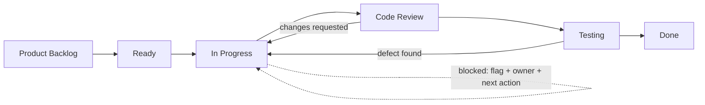

# Kanban Board

> **Status of this document: [PROPOSED] workflow + [RECONSTRUCTED] card snapshot.** No Kanban board existed in the repository. The snapshot below is *rebuilt from Git history and the working tree as of 2026-10-28*. It is **not** a historical record of a board the team used.

## 1. Workflow

### 1.1 Columns [PROPOSED]

| Column | Meaning | Enter when | Leave when | Who advances | Typical blockers | WIP limit |
|---|---|---|---|---|---|---|
| Product Backlog | Ordered ideas and requirements ([product-backlog](product-backlog.md)) | Item written as a user story | Meets Definition of Ready | Product owner role | Ambiguous requirement | none |
| Ready | Refined, sized, can start now | Has acceptance criteria, dependencies known, ≤2 days of work | A member pulls it | Member who pulls | Unknown dependency | **5** |
| In Progress | Being built | A member pulls it; branch created | Pull request opened | Assignee | External API/quota/config; waiting on another card | **4 total, ≤2 per person** |
| Code Review | Pull request open | PR opened with description and self-check done | Reviewer approves (a *different* member) | Reviewer | Reviewer unavailable; large diff | **3** |
| Testing | Verifying acceptance criteria | Review approved | All acceptance criteria demonstrated, tests added/updated | Tester (reviewer or author's pair) | No test environment; missing credentials | **2** |
| Done | Meets Definition of Done (below) | Testing passed, docs updated, merged to main | — | — | — | none |

### 1.2 Why WIP limits help, and how to apply them

- **Why:** a small team that starts many things finishes few. The commit history shows bursts of large cross-cutting commits (e.g. `d078b21`: 261 files in one change); limits push toward smaller, reviewable slices.
- **Blocked work:** mark the card *Blocked*, name the blocker, the owner of the next action and a date to re-check. Blocked cards still count against WIP so they cannot be silently abandoned. Examples seen during development: a provider API not enabled for the cloud project; provider free-tier quota exhausted; trial-account restrictions on a telephony provider.
- **Avoiding multitasking:** pull a new card only when your own In Progress count is below the limit; help review before starting new work ("stop starting, start finishing").
- **Review and testing in the flow:** review and testing are *columns with limits*, so a pile-up there is visible immediately and becomes the next thing to fix.
- **Prioritisation:** order the Ready column top-to-bottom by MoSCoW priority, then by dependency (unblockers first), then by value.
- **During team discussions:** walk the board right-to-left (Done → Testing → Review → In Progress → Ready). Ask of every card "what would let this move?"

### 1.3 Definition of Ready [PROPOSED]
User story and acceptance criteria written · dependencies identified · estimate ≤2 days · test approach noted · no unanswered question.

### 1.4 Definition of Done [PROPOSED]
Code merged to `main` via reviewed PR · acceptance criteria demonstrated · automated test added or updated (or an explicit, reviewed reason why not) · no secrets in code or logs · security impact considered (auth, data isolation, input validation) · documentation updated (README/`DB_SCHEMA.md`/this package where relevant) · deploys with `docker compose up` without manual steps.

## 2. Reconstructed card snapshot (as of 2026-10-28)

Card IDs `T-nnn` are used consistently across this package. "Member" IDs: **M1** Vishakha Sharma, **M2** Prajinraj Ranawat, **M3** Fatema Shakir, **AI-S1** the AI-assisted session of 2026-10-28 (see [team-contributions](team-contributions.md)). Where no evidence names an owner the card says *Ownership requires confirmation from the project team.*

### 2.1 Done (committed history) — [RECONSTRUCTED], evidence is Git

| Task | Title | Feature | Priority | Assignee (evidence) | Depends on | Evidence |
|---|---|---|---|---|---|---|
| T-001 | Landing page and UI shell | F-01 | Should | M1 [PARTIALLY VERIFIED] | — | `f186bf3`/`676bb25` "frontend commit" (2026-04-10) |
| T-002 | Dashboard, first OAuth integration | F-03, F-07 | Must | M1 [PARTIALLY VERIFIED] | T-001 | `3a48472`/`1b62977` "dashboard and oauth done" |
| T-003 | Fix GitHub OAuth; nested `providers[]` Mongo structure; duplicate-callback guard | F-07 | Must | M2 [PARTIALLY VERIFIED] | T-002 | `5d647c6`/`9920198` (message lists the fixes) |
| T-004 | Orchestrator, human-in-the-loop flow, DAG generation, DagPanel | F-04, F-05 | Must | M2 [PARTIALLY VERIFIED] | T-003 | `941b6c6`/`97a18fc` |
| T-005 | README rewrite | F-14 | Should | M2 (`19198fa`, `635f6d6`), M1 (`ef4ed21`) | — | commits |
| T-006 | Fix ReactFlow crash (missing node positions) | F-05 | Must | M2 | T-004 | `d078b21` |
| T-007 | Railway deployment configuration | F-13 | Should | M2 | — | `208ca19` |
| T-008 | Repository cleanup (build artefacts, `.gitignore`, restore sources) | F-13 | Should | M2 | — | `6dd4781`, `e1aba37`, `652afae`, `e680aca` |
| T-009 | Edits to `src/app/api/integrations/route.ts` and `useSessionManager.ts` through the web UI | F-07, F-03 | Must | M1 | T-003 | `ab45fbf`, `ee8fea3`, `fe84282`, `1a896bb`, `108f04a` (2026-04-12) |
| T-010 | Upload and edit architecture documentation | F-14 | Should | M2 (`402974e`), M1 (`3296053`) | — | 2026-08-06 |

### 2.2 Code Review column — implemented in the working tree, **not committed or reviewed**

All cards below were produced in the AI-assisted session of 2026-10-28. They are in "Code Review" because *no review has happened*; none has been merged. Proposed owners and reviewers: [work-allocation](work-allocation.md) (owner = the member who studies, tests and commits it under their own name; reviewer = the next member in the rotation).

| Task | Title | Feature | Priority | Depends on | Definition of Done status | Evidence |
|---|---|---|---|---|---|---|
| T-011 | Email/password sign-up and login; Google as identity-only | F-02 | Must | T-002 | Code done · tests NOT written · ad-hoc checks only | `git status`; `src/lib/nextauth.ts`, `src/app/api/auth/signup/route.ts` |
| T-012 | Signed OAuth state; Google connector; remove unauthenticated write endpoints | F-07, F-12 | Must | T-011 | Code done · ad-hoc state-rejection checks | `src/lib/oauthState.ts`, `src/app/api/oauth/**` |
| T-013 | Backend JWT authentication; AES-256-GCM key encryption | F-12 | Must | T-011 | Code done · TS↔Python crypto round-trip checked ad hoc | `mcp_agent/app/{auth,crypto}.py`, `src/lib/{crypto,backendToken}.ts` |
| T-014 | Own-key LLM support (5 providers) and key switcher | F-11 | Must | T-011, T-013 | Code done · live provider checks run only with invalid keys | `src/lib/llmKeys.ts`, `mcp_agent/app/services/llm.py` |
| T-015 | LangGraph agent state, plan validation and retry, prompt tuning for weaker models | F-04 | Must | T-014 | Code done · fake-model scenario checked | `mcp_agent/app/services/{agent_graph,plan,orchestrator}.py` |
| T-016 | Dependency graph builder, layered layout, parallel executor, failure isolation | F-05, F-06 | Must | T-015 | Code done · stubbed-tool scenario checked | `plan.py`, `executor.py` |
| T-017 | Tool fixes: `github.update_repo`; Twilio requires an explicit recipient and trial-safe TwiML | F-08 | Should | T-016 | Code done · no real call placed by the documentarian | `github_mcp/server.py`, `twilio_mcp/main.py` |
| T-018 | Local Docker run: host-gateway DB URI, ports bound to localhost | F-13 | Should | T-013 | Containers started and healthy (ad hoc) | `docker-compose.yml` |
| T-019 | Database schema document | F-14 | Should | T-013 | Written; needs review | `DB_SCHEMA.md` |
| T-020 | Agile documentation package | F-14 | Must | — | Generated from repository evidence; needs team review | `docs/agile/` |

### 2.3 Ready / Backlog — [PROPOSED], not started

| Task | Title | Feature | Priority | Column | Depends on | Definition of Done (task-specific) |
|---|---|---|---|---|---|---|
| T-030 | Review the working tree in small PRs and commit (umbrella for T-011…T-019; owners in [work-allocation](work-allocation.md)) | all | Must | Ready | — | Each of T-011…T-019 reviewed by a member other than its owner; merged to `main` |
| T-031 | Rotate any credential that was pasted into chats or logs during development | F-12 | Must | Ready | — | New secrets in `.env` files; old ones revoked [TEAM CONFIRMATION REQUIRED] |
| T-032 | Unit and API tests for plan validation, graph builder, executor, auth routes (split into T-032.1, T-032.2, T-032.3 — see [work-allocation](work-allocation.md)) | all | Must | Ready | T-030 | ≥1 test per acceptance criterion in PB-001/003/004/005; tests run in CI |
| T-033 | CI workflow (type-check, Python syntax/lint, tests) | F-13 | Must | Backlog | T-032 | Workflow passes on `main` |
| T-034 | Consolidate branches (`main` vs `production`) | F-13 | Must | Ready | — | One authoritative branch; policy documented |
| T-035 | Encrypt connector tokens in `integrations` | F-07 | Must | Backlog | T-030 | No plaintext tokens in DB; all tool servers decrypt |
| T-036 | Per-user Twilio connector | F-08 | Should | Backlog | T-035 | No shared platform Twilio account |
| T-037 | Update `ARCHITECTURE_DOCUMENTATION.md` | F-14 | Should | Backlog | T-030 | Matches the code; reviewed |
| T-038 | Permissioned sharing for workflow links | F-10 | Should | Backlog | T-030 | Only chats flagged shared are public |
| T-039 | Cross-provider plan-quality benchmark | F-04 | Could | Backlog | T-032 | Method and results recorded |
| T-040 | Update landing-page copy (providers, claims) | F-01 | Should | Backlog | — | Copy matches current provider support; reviewed |

## 3. WIP check on the reconstructed snapshot

Ten cards are in Code Review against a proposed limit of 3 — that is the **observable bottleneck**: a large amount of finished-but-unreviewed work. The first action under the proposed process is T-030 (review and merge in small slices) before any new feature starts.

Related: [agile-methodology](agile-methodology.md) · [sprint-plan](sprint-plan.md) · [agile-metrics](agile-metrics.md)
