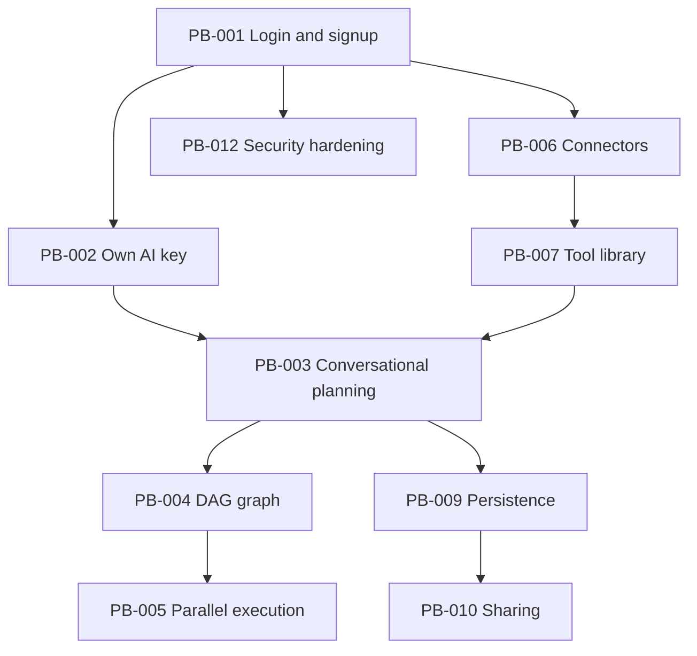

# Product Backlog

Story points are **[PROPOSED]** relative estimates (Fibonacci) made retrospectively for planning; they are not historical effort. "Implementation status" and "Testing status" come from the repository (see [feature-development-history](feature-development-history.md)). **No automated test exists for any item**, so every testing status is `NOT EXECUTED` except where a static check or an ad-hoc session check is cited ([testing-and-quality-assurance](testing-and-quality-assurance.md)).

Priority = MoSCoW for the *current* scope. Origin: **B** = baseline commit history, **W** = uncommitted working tree (2026-10-28 session).

**Product Goal [PROPOSED]:** "A signed-in user can describe a multi-tool task in natural language, review the resulting dependency graph, and execute it safely against their own connected accounts using their own AI provider key."

## Implemented functionality (documented retrospectively)

### PB-001 — Account registration and login (F-02) · Must · 5 SP · Origin B+W
- **User story:** As a visitor, I want to sign up and log in with email and password or Google so that my workflows and connections are private to me.
- **Value:** Per-user data isolation.
- **Acceptance criteria:** valid credentials create a session; wrong password is rejected with no account disclosure; passwords stored only as bcrypt hashes; duplicate email returns 409; protected APIs return 401 without a session.
- **Dependencies:** MongoDB `users`. **Code:** `src/lib/nextauth.ts`, `src/lib/users.ts`, `src/app/api/auth/signup/route.ts`, `src/components/auth/*`, `src/middleware.ts`.
- **Status:** Implemented (email/password is uncommitted; Google sign-in is baseline). **Testing:** NOT EXECUTED (automated). Ad-hoc session checks cover signup, duplicate, weak password, wrong/right login, 401s → TC-A01–A05.
- **Uncertainties:** whether the original team intended email/password at all — the committed forms called `/api/auth/login`, which did not exist. [TEAM CONFIRMATION REQUIRED]

### PB-002 — Per-user AI provider key (F-11) · Must · 8 SP · Origin W
- **User story:** As a user without a paid platform plan, I want to add my own OpenAI, Claude, Groq, OpenRouter or Gemini key so that planning is billed to my account.
- **Acceptance criteria:** key format validated; key checked live with the provider; stored AES-256-GCM encrypted; never returned to the browser; user can switch the active key and delete keys.
- **Dependencies:** PB-001. **Code:** `src/lib/llmKeys.ts`, `src/lib/crypto.ts`, `src/app/api/llm-keys/route.ts`, `src/components/dashboard/LlmKeyModal.tsx`, `mcp_agent/app/services/llm.py`, `mcp_agent/app/crypto.py`.
- **Status:** Implemented, uncommitted. **Testing:** ad-hoc only (TC-K01–K05); no real Gemini/Groq planning quality benchmark exists. [PARTIALLY VERIFIED]

### PB-003 — Conversational planning with human approval (F-04) · Must · 13 SP · Origin B+W
- **User story:** As a user, I want to describe a task in chat and review a plan before anything runs so that I stay in control.
- **Acceptance criteria:** assistant asks one clarifying question when required values are missing; produces a plan with only known tools and required parameters; asks for confirmation; remembers context between turns; does not invent phone numbers/IDs.
- **Dependencies:** PB-002, PB-007. **Code:** `mcp_agent/app/services/{orchestrator,plan,agent_graph,gemini,llm}.py`, `mcp_agent/app/routes/query.py`, `src/hooks/useSessionManager.ts`.
- **Status:** Implemented. Baseline (commit `941b6c6`) used a single global OpenAI key and a stateless endpoint; the working tree adds LangGraph state, validation with retry, and multi-provider support. **Testing:** ad-hoc with a fake model server (TC-P01–P04). [PARTIALLY VERIFIED]

### PB-004 — Dependency-aware DAG visualisation (F-05) · Must · 8 SP · Origin B+W
- **User story:** As a user, I want to see the plan as a graph with parallel branches so that I understand what runs when.
- **Acceptance criteria:** nodes without mutual dependencies appear side by side; edges derive from `depends_on` and `{node.field}` references; invalid/missing positions never crash the canvas.
- **Code:** `src/components/dashboard/DagPanel.tsx`, `src/lib/dagUtils.ts`, `mcp_agent/app/services/plan.py` (`build_graph`).
- **Status:** Implemented. The earlier crash on missing node positions was fixed in `d078b21`. **Testing:** ad-hoc offline graph test (TC-G01). [PARTIALLY VERIFIED]

### PB-005 — Parallel execution with failure isolation (F-06) · Must · 8 SP · Origin B+W
- **User story:** As a user, I want independent steps to run together and dependent steps to be skipped if a prerequisite fails so that runs are fast and safe.
- **Acceptance criteria:** nodes run in waves (≤4 concurrent); a node whose dependency failed is marked skipped; readable error messages for common provider failures; final status persisted.
- **Code:** `mcp_agent/app/services/executor.py`, `mcp_agent/app/routes/query.py`. **Status:** Implemented (working tree). **Testing:** ad-hoc with stubbed tool calls (TC-X01). One real Gmail workflow was run by a user on 2026-10-28 (container log evidence, not persisted). [PARTIALLY VERIFIED]

### PB-006 — Connect GitHub, Google and Discord accounts (F-07) · Must · 8 SP · Origin B+W
- **User story:** As a user, I want to authorise each service through its own consent screen so that DAGent can act on my behalf.
- **Acceptance criteria:** OAuth `state` is signed, expiring and bound to the user; callbacks reject forged or foreign state; refresh tokens stored for Google; connected providers listed without exposing tokens; disconnect supported.
- **Code:** `src/app/api/oauth/**`, `src/lib/{oauthState,integrations}.ts`, `src/app/api/integrations/**`.
- **Status:** Implemented. **Testing:** forged/foreign-state rejection checked ad hoc (TC-O01–O02); real consent flows for GitHub/Google/Discord not exercised end-to-end by the documentarian. **Known gap:** connector tokens are stored unencrypted (see PB-021).

### PB-007 — Tool library for external services (F-08) · Must · 21 SP · Origin B+W
- **User story:** As a user, I want workflows to use GitHub, Gmail, Sheets, Discord and SMS/voice tools so that real tasks can be automated.
- **Acceptance criteria:** 56 tools exposed over HTTP; required parameters enforced before calls; tools run as the requesting user only.
- **Code:** `mcp_agent/{github,google,discord,twilio}_mcp/`, `mcp_agent/app/services/executor.py` (`REQUIRED_FIELDS`).
- **Status:** Implemented; `github.update_repo` and the Twilio destination rule were added in the working tree. **Testing:** endpoint registration and rejection of empty input checked ad hoc (TC-T01–T02); individual tools mostly **NOT EXECUTED**.
- **Uncertainty:** authorship of `discord_mcp` and `twilio_mcp` cannot be established from commit history (they appear inside large initial/bulk commits). [TEAM CONFIRMATION REQUIRED]

### PB-008 — Dashboard with workflow list and chat (F-03) · Must · 8 SP · Origin B
- **User story:** As a user, I want a workspace showing my workflows and a chat so that I can switch between tasks.
- **Code:** `src/components/dashboard/*`, `src/app/dashboard/page.tsx`. **Status:** Implemented. **Testing:** NOT EXECUTED.

### PB-009 — Persist chats and plans (F-09) · Must · 5 SP · Origin B
- **User story:** As a user, I want my conversations and plans saved so that I can return later.
- **Code:** `src/lib/models/Chat.ts`, `src/app/api/chats/**`. **Status:** Implemented; `/api/chats/append` previously trusted a `user_id` from the request body and now uses the session. **Testing:** NOT EXECUTED.

### PB-010 — Share a workflow (F-10) · Should · 3 SP · Origin B
- **User story:** As a user, I want to share a read-only view of a workflow so that colleagues can inspect it.
- **Code:** `src/components/dashboard/WorkflowShareModal.tsx`, `src/app/dag/[id]/page.tsx`, `src/app/api/chats/[id]/public/route.ts`.
- **Status:** Implemented. **Risk:** the public route serves any chat by its ObjectId without a share flag. **Testing:** NOT EXECUTED. [PARTIALLY VERIFIED]

### PB-011 — Landing page (F-01) · Should · 5 SP · Origin B
- **User story:** As a visitor, I want to understand the product and start signing up. **Code:** `src/app/page.tsx`, `src/components/landing/*`. **Status:** Implemented. **Testing:** NOT EXECUTED.

### PB-012 — Security hardening of platform APIs (F-12) · Must · 13 SP · Origin W
- **User story:** As a user, I want other people unable to read or change my data so that my connected accounts stay safe.
- **Acceptance criteria:** agent backend derives the user only from a signed 10-minute JWT; unauthenticated integration-write endpoints removed; AES-256-GCM for stored LLM keys; rate limits on signup, login and key checks; tool servers bound to `127.0.0.1`.
- **Code:** `src/lib/{crypto,backendToken,oauthState,rateLimit}.ts`, `mcp_agent/app/{auth,crypto}.py`, `docker-compose.yml`. **Status:** Implemented, uncommitted. **Testing:** ad-hoc (TC-S01–S06). Rate limiting is in-memory (single instance only).

### PB-013 — Containerised deployment (F-13) · Should · 5 SP · Origin B+W
- **Code:** `Dockerfile`, `docker-compose.yml`, `railway.toml`. **Status:** Configuration exists; **no deployment record** found. **Testing:** a local `docker compose up --build` run on 2026-10-28 started all five services (ad hoc). [PARTIALLY VERIFIED]

## Proposed improvements (NOT implemented)

| ID | Item | Priority | SP [PROPOSED] | Depends on | Acceptance criteria (summary) |
|---|---|---|---|---|---|
| PB-020 | Automated test suite (unit + API) and CI | Must | 13 | — | Tests for plan validation, graph builder, executor, auth routes; CI runs on every push; coverage reported |
| PB-021 | Encrypt connector OAuth tokens at rest | Must | 8 | PB-006, PB-007 | Tokens in `integrations` stored `enc:v1:`; tool servers decrypt; no plaintext remains |
| PB-022 | Per-user Twilio connector | Should | 8 | PB-006 | Each user supplies their own Twilio credentials; no shared platform account |
| PB-023 | Share link with explicit permission flag | Should | 3 | PB-010 | Only chats marked shared are public; revoke supported |
| PB-024 | Commit and branch consolidation (single `main`) | Must | 2 | — | One authoritative branch; `production` strategy documented |
| PB-025 | Update `ARCHITECTURE_DOCUMENTATION.md` to current design | Should | 3 | — | Matches working tree; reviewed by both members |
| PB-026 | Re-run failed branch / resume execution | Could | 8 | PB-005 | Failed workflow can resume without repeating successes |
| PB-027 | Team workspaces and roles (README roadmap) | Won't (now) | 21 | PB-001 | Out of current scope |
| PB-028 | Plan-quality benchmark across providers | Could | 5 | PB-020 | Fixed prompt set scored per provider with a recorded method |

## Dependency overview

See also: [kanban-board](kanban-board.md) · [sprint-plan](sprint-plan.md) · [feature-development-history](feature-development-history.md)
