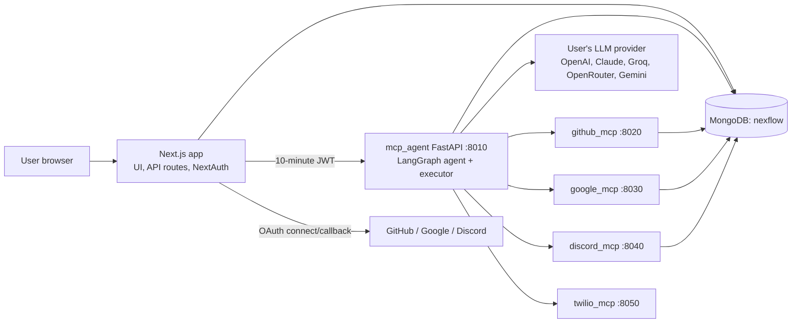

# Project Overview — DAGent

> Evidence labels used in this package: **[VERIFIED]**, **[PARTIALLY VERIFIED]**, **[TEAM CONFIRMATION REQUIRED]**, **[PROPOSED]**, **[UNKNOWN]**. See [README](README.md) for their definitions.

## 1. Purpose

DAGent turns a plain-English request ("create a private repo, add a README, email me when it is done") into a **directed acyclic graph (DAG) of tool calls**, shows the graph to the user for approval (human-in-the-loop), and then executes it against real services (GitHub, Gmail/Google Sheets, Discord, Twilio). [VERIFIED — `README.md`, `mcp_agent/app/services/orchestrator.py`, `mcp_agent/app/services/executor.py`]

Problem addressed (from the project README): repetitive multi-tool workflows currently require manual work across several apps; DAGent lets a user describe the workflow once and re-run it. [PARTIALLY VERIFIED — stated by the team in `README.md`; no user research evidence found]

## 2. Stakeholders and intended users

| Stakeholder | Interest | Evidence |
|---|---|---|
| End users (developers / small teams automating cross-tool tasks) | Build and run workflows by conversation | `README.md` "The Problem / The Solution" [PARTIALLY VERIFIED] |
| Project team (M1, M2, M3 — see [team-contributions](team-contributions.md)) | Deliver and assess the project | `git log` [VERIFIED] |
| Course assessors | Evaluate implementation, planning, collaboration | Assignment context [TEAM CONFIRMATION REQUIRED] |
| Third-party providers (GitHub, Google, Discord, Twilio, LLM vendors) | Their APIs and quotas constrain the product | Code in `src/app/api/oauth/*`, `mcp_agent/*_mcp/` [VERIFIED] |

Team: three members per the team lead (2026-10-28): M1 Vishakha Sharma, M2 Prajinraj Ranawat, M3 Fatema Shakir [PARTIALLY VERIFIED — stated by the team lead, not recorded in the repository; only M1 and M2 have Git identities]. Course name, supervisor and deadlines are **[UNKNOWN]**.

## 3. Scope

**In scope (implemented in the working tree):** account sign-up/login, Google sign-in, per-user LLM key (5 providers), chat-driven planning, DAG visualisation and layout, parallel execution, connectors for GitHub/Google/Discord, 56 tools across four Dockerised tool servers, chat persistence, sharing, containerised deployment configuration.

**Out of scope / not found:** automated tests, CI/CD, billing, team workspaces (README roadmap item), scheduled/triggered workflows, per-user Twilio accounts, encryption of connector OAuth tokens at rest (see [challenges-and-risks](challenges-and-risks.md)).

## 4. Technology stack [VERIFIED — `package.json`, `mcp_agent/requirements.txt`, `docker-compose.yml`]

| Layer | Technology |
|---|---|
| Frontend | Next.js 14 (App Router), React 18, TypeScript, Tailwind CSS, Redux Toolkit, Zustand, framer-motion, GSAP, ReactFlow |
| Auth | NextAuth v5 (JWT sessions): email+password (bcrypt) and Google |
| Application API | Next.js route handlers (`src/app/api/**`) |
| Agent backend | Python 3.12, FastAPI, LangGraph + `langgraph-checkpoint-mongodb`, PyJWT, `cryptography` |
| LLM access | OpenAI SDK (also used for Groq/OpenRouter/Gemini OpenAI-compatible endpoints), Anthropic SDK |
| Tool servers | FastAPI microservices: `github_mcp`, `google_mcp`, `discord_mcp`, `twilio_mcp` (+ demo `multiplication_mcp`) |
| Data | MongoDB (database `nexflow`) via `mongodb` driver, Mongoose, PyMongo |
| Deployment | Docker, Docker Compose, Railway (`railway.toml`) |

## 5. Architecture

Request flow for one chat turn [VERIFIED — `src/hooks/useSessionManager.ts`, `mcp_agent/app/routes/query.py`, `mcp_agent/app/services/agent_graph.py`]:

1. Browser requests a short-lived token from `GET /api/backend-token` (requires a logged-in session).
2. Browser calls `POST /agent/message` with only the new message; the backend owns conversation state (LangGraph checkpoints in MongoDB, 7-day TTL).
3. Graph: detect required connectors → (blocked if a connector or LLM key is missing) → plan → validate/retry → reply.
4. On approval the browser calls `POST /execute-dag`; the executor runs ready nodes in parallel "waves" and skips nodes whose dependencies failed.

Pre-existing, more detailed design documentation: [`ARCHITECTURE_DOCUMENTATION.md`](../../ARCHITECTURE_DOCUMENTATION.md) (1,508 lines, added 2026-08-06). **It describes the earlier architecture** (single global `OpenAI` key, unauthenticated backend endpoints) and has not been updated for the changes described below. [VERIFIED by comparing the file with the working tree]

## 6. Feature inventory

"Baseline" = present in committed history up to `3296053`. "Working tree" = present on disk but **not committed** (the 2026-10-28 AI-assisted session, see [team-contributions](team-contributions.md)).

| ID | Feature | Main code | Origin | Status |
|---|---|---|---|---|
| F-01 | Landing page and marketing UI | `src/app/page.tsx`, `src/components/landing/*`, `src/components/shared/*` | Baseline | Implemented |
| F-02 | Authentication and accounts | `src/lib/nextauth.ts`, `src/lib/auth.config.ts`, `src/lib/users.ts`, `src/app/api/auth/*`, `src/components/auth/*` | Baseline (Google only) + working tree (email/password) | Implemented |
| F-03 | Dashboard workspace | `src/components/dashboard/*`, `src/app/dashboard/page.tsx` | Baseline | Implemented |
| F-04 | Conversational workflow planner (human-in-the-loop) | `mcp_agent/app/services/{orchestrator,plan,agent_graph}.py`, `routes/query.py` | Baseline + working tree | Implemented |
| F-05 | DAG visualisation and layout | `src/components/dashboard/DagPanel.tsx`, `src/lib/dagUtils.ts`, `mcp_agent/app/services/plan.py` | Baseline + working tree | Implemented |
| F-06 | DAG execution engine | `mcp_agent/app/services/executor.py` | Baseline + working tree | Implemented |
| F-07 | OAuth connectors (GitHub, Discord, Google) | `src/app/api/oauth/*`, `src/lib/{oauthState,integrations}.ts` | Baseline + working tree | Implemented |
| F-08 | Dockerised tool servers (56 tools) | `mcp_agent/{github,google,discord,twilio}_mcp/` | Baseline + working tree | Implemented |
| F-09 | Chat and workflow persistence | `src/lib/models/Chat.ts`, `src/app/api/chats/*` | Baseline | Implemented |
| F-10 | Workflow sharing and export | `src/components/dashboard/WorkflowShareModal.tsx`, `src/app/dag/[id]/page.tsx` | Baseline | Implemented |
| F-11 | Bring-your-own LLM key (5 providers) | `src/lib/llmKeys.ts`, `src/app/api/llm-keys/route.ts`, `src/components/dashboard/LlmKeyModal.tsx`, `mcp_agent/app/services/llm.py` | Working tree | Implemented, uncommitted |
| F-12 | Security hardening | `src/lib/{crypto,backendToken,oauthState,rateLimit}.ts`, `mcp_agent/app/{auth,crypto}.py` | Working tree | Implemented, uncommitted |
| F-13 | Containerisation and deployment configuration | `Dockerfile`, `docker-compose.yml`, `railway.toml` | Baseline + working tree | Implemented (no deployment evidence) |
| F-14 | Project documentation | `README.md`, `ARCHITECTURE_DOCUMENTATION.md`, `DB_SCHEMA.md`, `docs/agile/` | Baseline + working tree | Partial |

Tool counts (counted from `@app.post("/invoke/…")` endpoints): GitHub 21, Google 20 (11 Gmail, 9 Sheets), Discord 10, Twilio 5 = **56**, plus a one-tool demo server. [VERIFIED]

Size: ≈7,400 lines of TypeScript/TSX and ≈3,700 lines of Python (excluding dependencies and build output) in the working tree. [VERIFIED by line count on 2026-10-28]

## 7. Data model summary

Collections in MongoDB `nexflow`: `users`, `integrations` (one document per user with a `providers[]` array), `llm_keys` (encrypted), `chats`, `checkpoints`/`checkpoint_writes` (agent memory), legacy `sessions`. Full definition: [`DB_SCHEMA.md`](../../DB_SCHEMA.md). [VERIFIED]

## 8. What the repository does not tell us

- Who defined the original requirements and when. [UNKNOWN]
- Whether any production deployment (Railway or otherwise) was ever made. [UNKNOWN — config exists, no deployment records]
- Whether GitHub Issues, pull requests or a Projects board exist on the remote `origin` (the remote was deliberately **not queried**; only local Git data was used). [TEAM CONFIRMATION REQUIRED]
