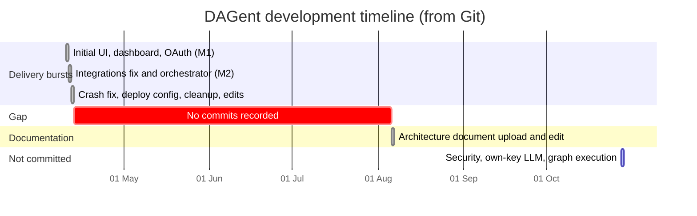

# Project Timeline

> **Source:** `git log --all` (all timestamps `+0530`). Dates and commit hashes are **[VERIFIED]**. Where two hashes are shown (e.g. `13ca5da`/`97d96b4`) the same change exists on two branches (see ISS-004). The "interpretation" column is analysis, not a historical statement. Periods with no commits are shown as gaps; nothing is assumed to have happened in them.

## 1. Event log

| Date and time | Hash(es) | Author (member) | Change | Interpretation [PROPOSED] |
|---|---|---|---|---|
| 2026-04-10 16:16 | `13ca5da` / `97d96b4` | Vishakha (M1) | "Initial commit" — 146 files; includes `.next` build output and root `test.py` | Repository created with the first application skeleton |
| 2026-04-10 16:20 | `df65bc1` / `8ab9413` | M1 | "Initial commit" (1 file) | Small follow-up |
| 2026-04-10 16:31 | `f186bf3` / `676bb25` | M1 | "frontend commit" — about 70 files | UI built |
| 2026-04-10 23:26 | `3a48472` / `1b62977` | M1 | "dashboard and oauth done" — about 175–185 files | Dashboard and first OAuth |
| 2026-04-11 03:10 | `5d647c6` / `9920198` | Prajinraj Ranawat (M2) | Fix GitHub OAuth and MongoDB integration structure | Integration data model stabilised |
| 2026-04-11 08:16 | `941b6c6` / `97a18fc` | M2 | Orchestrator, human-in-the-loop, DAG generation, DagPanel | Core planning feature added |
| 2026-04-11 11:22 / 11:27 | `19198fa`, `635f6d6` | Prajinraj (M2) | README updates | Documentation |
| 2026-04-12 06:28 | `d078b21` | M2 | ReactFlow crash fix with position guards (261 files) | Stabilisation |
| 2026-04-12 06:38 | `208ca19` | M2 | Railway deployment configuration | Deployment preparation |
| 2026-04-12 06:43–07:07 | `6dd4781`, `e1aba37`, `652afae`, `e680aca` | M2 | Remove build artefacts, complete `.gitignore`, "restore all source files" | Repository cleanup (ISS-001, ISS-002) |
| 2026-04-12 08:08–08:29 | `ab45fbf`, `ee8fea3`, `fe84282`, `1a896bb` | Vishakha Sharma (M1) | Four edits to `src/app/api/integrations/route.ts` | Web-UI edits; revert/re-apply pattern (ISS-005) |
| 2026-04-12 09:37 | `108f04a` | M1 | Edit `src/hooks/useSessionManager.ts` | Session manager fix |
| 2026-04-12 11:21 | `ef4ed21` | M1 | README update (301 insertions, 185 deletions) | Documentation |
| *2026-04-13 → 2026-08-05* | — | — | **No commits recorded (115 days; 116 days between the last commit before and the first after)** | Reason [UNKNOWN] |
| 2026-08-06 22:21 | `402974e` | Prajinraj (M2) | "Add files via upload" — `ARCHITECTURE_DOCUMENTATION.md` (1,508 lines) | Design documentation added |
| 2026-08-06 22:54 | `3296053` | M1 | Edit architecture document (1 line) | Documentation tweak |
| 2026-10-28 | *(uncommitted)* | AI-S1 | 66 changed entries: authentication, per-user AI keys, signed OAuth state, backend JWT, LangGraph agent, dependency-graph planner, parallel executor, tool fixes, Docker local run, schema document | Not in history; see [team-contributions](team-contributions.md) §4 |

## 2. Branch picture

| Branch | Head | Notes |
|---|---|---|
| `production` (local, tracked as `origin/production`) | `3296053` | Contains the documentation commits of 2026-08-06; checked out in this working tree |
| `origin/main` | `ab45fbf` | Stops at the second `route.ts` edit on 2026-04-12 |
| `origin/prajinraj` | `635f6d6` | Stops at the README update of 2026-04-11 |

Which branch is authoritative is **[TEAM CONFIRMATION REQUIRED]** (D1 in [team-verification-checklist](team-verification-checklist.md)).

## 3. What is missing for a richer timeline

Meeting dates, milestone and submission deadlines, task start/finish dates, demo dates, deployment dates, and any non-Git work (research, design, testing). A fill-in template follows.

| Date | Event type (meeting / milestone / demo / deployment / decision) | Who | Summary | Evidence |
|---|---|---|---|---|
| | | | | |

Related: [agile-metrics](agile-metrics.md) · [sprint-plan](sprint-plan.md)
