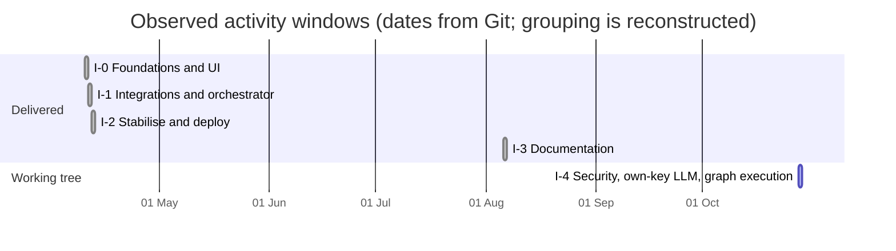

# Sprint and Iteration Plan

> **Status: [PROPOSED] / [RECONSTRUCTED].** The team left no evidence of Scrum sprints, planning meetings, reviews or retrospectives. Therefore:
> - Part A groups the *observed activity windows* into iterations. **Dates are real commit dates** [VERIFIED]; the iteration names, goals and story selections are a **retrospective reconstruction** [PROPOSED].
> - Part B is a **forward-looking** sprint plan for the remaining backlog [PROPOSED].
> - **No velocity, completed-point totals, attendance or review outcomes are stated**, because none can be established.

**Actual vs proposed sprint:** an *actual* sprint is a time-box the team planned, committed to and reviewed — none is evidenced. A *proposed* sprint is a plan someone could follow. Every sprint in this file is the second kind.

## Product Goal [PROPOSED]
A signed-in user can describe a multi-tool task in natural language, review the resulting dependency graph, and execute it safely against their own connected accounts using their own AI provider key. (See [product-backlog](product-backlog.md).)

## Part A — Reconstructed iterations from observed activity

| Iteration | Window | Activity evidence | Reconstructed goal [PROPOSED] | Items | Outcome |
|---|---|---|---|---|---|
| I-0 | 2026-04-10 | 4 unique changes: initial commits and "frontend commit", "dashboard and oauth done" (M1) | Stand up the Next.js application, UI shell and first OAuth integration | PB-011, PB-008, PB-006 (first version), PB-001 (Google only) | UI and first integration existed by 23:26 [VERIFIED by commit] |
| I-1 | 2026-04-11 | 4 unique changes: GitHub OAuth/Mongo fix, orchestrator + DAG feature, README (M2) | Make integrations reliable and add planning | PB-006 fixes, PB-003, PB-004 (first version), PB-007 | Orchestrator, `/orchestrate`, `/execute-dag`, DagPanel committed [VERIFIED] |
| I-2 | 2026-04-12 | 12 unique changes: crash fix, Railway config, repository cleanup, 5 web-UI edits, README (M1 + M2) | Stabilise and prepare to deploy | PB-004 fix, PB-013, PB-009/PB-007 touch-ups | Deployment configuration committed; no deployment record [PARTIALLY VERIFIED] |
| I-3 | 2026-08-06 | 2 unique changes: architecture document upload and edit | Document the design | PB-025 (first version) | Document exists but is now out of date |
| I-4 | 2026-10-28 | 66 uncommitted file changes (38 modified, 23 new, 5 deleted) | Close security gaps, remove the shared AI key, support more providers, run graphs in parallel | PB-001 (email/password), PB-002, PB-003, PB-005, PB-012 | Implemented in the working tree, **not committed, not reviewed**; AI-assisted session — see [team-contributions](team-contributions.md) |

Per iteration there is **no** verifiable sprint backlog, daily coordination record, review or retrospective. These columns are marked [UNKNOWN] and listed in the [team-verification-checklist](team-verification-checklist.md).

## Part B — Proposed forward plan (Scrumban cadence, 1-week sprints)

Definition of Ready and Definition of Done: see [kanban-board](kanban-board.md) §1.3–1.4. Coordination: a 15-minute sync twice a week or asynchronous written updates; planning (30 min) at the start of each sprint; review + retrospective (45 min) at the end of every second sprint. Estimates are relative [PROPOSED].

Owners and reviewers for every card are in [work-allocation](work-allocation.md) (round-robin across M1, M2 and M3). Story-point totals below are the planned load per member computed from that allocation. They are **not** capacity or velocity: no velocity history exists.

### Sprint 5 — "Land and verify the current work" — 29 SP (M1 10, M2 10, M3 9)
- **Sprint goal:** everything built on 2026-10-28 is reviewed, understood by its owner, and committed under that member's own name; shared credentials are rotated; the branch situation is resolved.
- **Backlog:** T-011 … T-019 (the review cards, umbrella T-030), T-031 (rotate credentials), T-034 (consolidate branches).
- **User stories verified by this sprint:** PB-001, PB-002, PB-003, PB-004, PB-005, PB-006, PB-007 (tool fixes), PB-012, PB-013, PB-024.
- **Dependencies:** none external; T-034 should finish before the first commits so the work lands on one branch.
- **Deliverables:** reviewed and merged pull requests; one authoritative `main`; rotated secrets.
- **Testing activities:** each owner re-runs the checks that were performed ad hoc ([testing-and-quality-assurance](testing-and-quality-assurance.md) TC-A…TC-D) and records the result on the card.
- **Acceptance:** `git status` clean on the working tree; every card has an owner who can explain it and a reviewer who approved it.
- **Risks:** large diffs (split PRs per card); reviewer availability; AI-assistance disclosure ([team-verification-checklist](team-verification-checklist.md) B3).

### Sprint 6 — "Tests, pipeline and data protection" — 26 SP (M1 12, M2 5, M3 9)
- **Sprint goal:** automated tests and CI protect the main behaviours; connector tokens are no longer stored in plaintext.
- **Backlog:** T-032.1, T-032.2, T-032.3 (tests TC-U01…TC-U10), T-033 (CI), T-035 (encrypt connector tokens).
- **User stories:** PB-020, PB-021.
- **Dependencies:** T-032 after T-030; T-033 after T-032; T-035 after T-030 and must update every tool server that reads tokens.
- **Deliverables:** passing test suite locally and in CI; migration of existing `integrations` documents.
- **Acceptance:** every acceptance criterion of PB-001, PB-003, PB-004 and PB-005 maps to an executed test; no plaintext token remains in the database.
- **Risks:** token migration; tests must use fake providers, not real users' keys.
- **Load note:** M1 carries more points this sprint than M2; use the swap rule in [work-allocation](work-allocation.md) §2 if that is a problem.

### Sprint 7 — "Own-account integrations, sharing and documentation" — 20 SP (M1 3, M2 9, M3 8)
- **Sprint goal:** no shared platform accounts; sharing is permissioned; documentation matches the code.
- **Backlog:** T-036 (per-user Twilio), T-037 (architecture document), T-038 (permissioned sharing), T-039 (provider benchmark), T-040 (landing copy).
- **User stories:** PB-022, PB-023, PB-025, PB-028, PB-011 (copy).
- **Dependencies:** T-036 after T-035; T-039 after T-032.
- **Risks:** telephony trial/regional restrictions; provider free-tier quotas — benchmark runs on fakes first, and live runs only with the key owner's explicit approval.

### Review and retrospective records
Not applicable yet — these sprints have not run. Template: [retrospective](retrospective.md) §5.

Related: [kanban-board](kanban-board.md) · [product-backlog](product-backlog.md) · [agile-methodology](agile-methodology.md)
